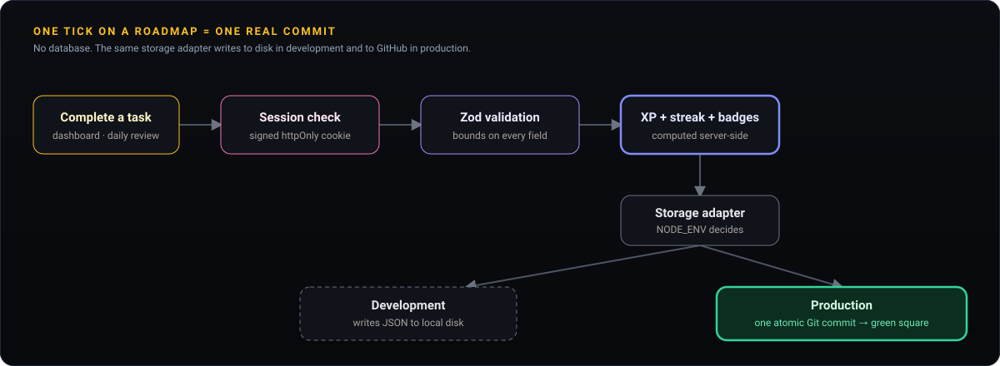
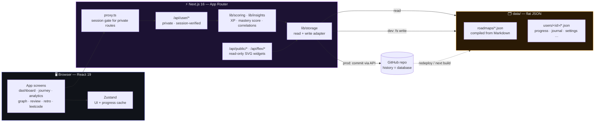

<div align="center">


<br/>

[](#-tech-stack)
[](#-tech-stack)
[](#-tech-stack)
[](#-the-storage-engine-your-commit-history-is-the-database)
[](#-the-storage-engine-your-commit-history-is-the-database)
[](#-analytics--local-insights)
[](#-deployment)
[](./LICENSE)

**A personal upskilling dashboard with no database. Every task you complete becomes a real Git commit — so your learning streak shows up on your actual GitHub contribution graph.**

</div>

---

## What is Mastery OS?

Mastery OS is a **single-owner, gamified progress tracker** for long-form learning. You feed it Markdown roadmaps; it turns them into trackable phases, weeks and tasks, then layers on the things that keep people going — XP, levels, streaks, achievements, a daily review and weekly retrospectives — plus analytics that run entirely on your own data.

1. **Multiple roadmaps at once** — two ship by default: a 24-week mastery plan (192 tasks) and an 8-week web-dev plan (56 tasks). Each has its own colour and start date.
2. **Game-style progression** — XP per task scaled by difficulty, a level curve, a 0–100 Mastery Score, and 23 achievements across four rarity tiers.
3. **Reflection built in** — a daily review (what you learned, what blocked you, mood/energy/focus, sleep and study hours) and a weekly retrospective.
4. **Insights that never leave your repo** — Pearson correlations, pace forecasting and weekly reports are computed locally. No external AI or analytics service is called.
5. **Embeddable proof of work** — public SVG widgets (heatmap, streak, stats, completion, level, trophy showcase) you can drop into a GitHub profile README.
6. **No database to run** — state lives in JSON files in the repository; in production each update is committed back through the GitHub API.

<br/>

<div align="center">

<sub>Animated in a browser (GitHub renders raw SVG natively) — a completed task flows through validation and scoring, then the storage adapter either writes to disk or makes a commit.</sub>
</div>

---

## Table of Contents

- [Why This Exists](#why-this-exists)
- [Architecture at a Glance](#-architecture-at-a-glance)
- [Screens](#-screens)
- [Roadmaps](#-roadmaps)
- [Gamification](#-gamification)
- [Analytics & Local Insights](#-analytics--local-insights)
- [Embeddable Widgets](#-embeddable-widgets)
- [The Storage Engine](#-the-storage-engine-your-commit-history-is-the-database)
- [Access & Security Model](#-access--security-model)
- [Data Model](#-data-model)
- [Tech Stack](#-tech-stack)
- [Getting Started](#-getting-started)
- [Configuration Reference](#-configuration-reference)
- [Deployment](#-deployment)
- [Project Layout](#-project-layout)
- [Project Snapshot](#-project-snapshot)
- [Roadmap](#-roadmap)
- [License](#-license)

---

## Why This Exists

Most learning trackers fail for the same two reasons: they're one more app with one more login that you stop opening, and the "progress" they show is private and easy to ignore. Mastery OS is built around the opposite bets:

- **Make the work visible where you already look.** Progress lands as commits, so consistency becomes a green square on a graph you already check.
- **Cost nothing to run.** No managed database, no paid tier — a flat-file store plus the GitHub API fits Vercel's free plan.
- **Keep the data yours.** Everything is plain JSON in your own repository; analytics run locally and nothing is sent to a third-party AI.
- **Make roadmaps cheap to change.** Edit a Markdown file, recompile, and the app follows.

---

## 🏗 Architecture at a Glance



---

## 🧭 Screens

| Screen | What it does |
|---|---|
| **Dashboard** | Progress ring, today's tasks, roadmap switcher, XP bar and a daily quote |
| **Journey** | Level, XP and the achievement catalogue, with pinnable showcase badges |
| **Knowledge Graph** | Roadmap weeks and their dependencies as an interactive node graph |
| **Analytics** | Heatmaps, radar and velocity charts, completion forecasting |
| **Daily Review** | Learned / blocked / difficult, plus mood, energy, focus, sleep and study hours |
| **Weekly Retrospective** | Structured weekly reflection |
| **LeetCode Tracker** | Solved problems grouped by skill or as a flat list, with XP per difficulty |
| **Resources Library** | Curated study resources |
| **Settings** | Profile, working hours, preferred study duration, per-roadmap start dates, XP tuning and public-widget toggles |
| **Public profile** *(in progress)* | A read-only profile page at `/p/<id>`, shown only if you mark your profile public — see the roadmap for what's left |

The interface is dark-first with a glassmorphism look, and a derived accent palette: your chosen primary hue is expanded into a full set of HSL accents. Animations use named easing curves and **downgrade to simple crossfades under `prefers-reduced-motion`**.

---

## 🗺 Roadmaps

Roadmaps are authored as Markdown in `data/roadmap-sources/` and compiled into structured JSON (phases → weeks → nodes) by a script:

```bash
npx tsx scripts/parse-roadmaps.ts
```

| Roadmap | Length | Tasks |
|---|---|---|
| 6-Month Mastery | 24 weeks | 192 |
| 8-Week Web Dev | 8 weeks | 56 |

- **Stable node IDs.** Each task gets an ID derived from a hash of its roadmap, phase, week and source line, so unchanged lines keep the same identity across recompiles and existing progress stays attached.
- **Rich nodes.** Each task carries a track, type, difficulty, time estimate, dependencies, resources and an optional checkpoint flag.
- **A manifest** (`_manifest.json`) lists every compiled roadmap with its colour and totals; the app reads it to build the switcher.
- **Per-roadmap start dates** live in your profile, so a roadmap can begin whenever you do.

> The compiler currently has format-specific parsers for the two bundled roadmaps. Adding a new roadmap shape means adding a parser function — see [Roadmap](#-roadmap) for the plan to generalise it.

---

## 🎮 Gamification

**XP per task** = `baseXP × difficulty multiplier`. Defaults are a base of 20 with multipliers of 2 / 5 / 8 for easy / medium / hard, and all of it is tunable in Settings.

**Levels** follow a curve of `100 × n^1.5` XP, so early levels come quickly and later ones take sustained effort.

**Mastery Score (0–100)** — fully documented, no black box:

| Component | Max | How it's computed |
|---|---|---|
| **Completion** | 40 | Share of tasks completed, weighted by difficulty (easy ×1, medium ×1.5, hard ×2) |
| **Streak** | 20 | `current streak ÷ 30`, capped at 1; halved if you've been inactive for more than a day |
| **Consistency** | 20 | Days active ÷ days since you started |
| **XP pace** | 20 | XP earned against the XP projected at your current completion rate |

**Achievements** — 23 across four rarity tiers (5 common, 7 rare, 6 epic, 5 legendary), from *First Step* to long-streak and volume milestones. Legendary badges get a subtle animated shimmer, and you can pin up to six to your showcase.

**Quotes** — a pool of 276, shown with a typing animation and optional speech, with a deterministic daily pick that avoids repeats until the pool is exhausted.

---

## 📈 Analytics & Local Insights

- **Visualisations** — heatmaps, radar charts, velocity graphs and a completion forecast based on a local linear fit.
- **Pearson correlations** — relationships between mood, energy, focus, sleep, study hours and productivity, computed from your own journal entries.
- **Programmatic weekly reports** — compiled from tracked metrics with plain code.

**No external AI or analytics service is involved.** Nothing you write in your journal is sent anywhere except your own repository.

---

## 🖼 Embeddable Widgets

Public, cache-controlled SVG routes let you show your progress on a GitHub profile README or portfolio. Replace the placeholders with your deployment's domain and your user ID:

```markdown


```

- **Opt-in privacy.** A widget only renders if your profile is marked public *and* that specific widget is switched on in settings — otherwise the route refuses.
- **Read-only.** These endpoints never write and expose only aggregate stats.
- **Cached for 30 minutes** via `Cache-Control`, so a popular README doesn't hammer your deployment.

---

## 💾 The Storage Engine: Your Commit History Is the Database

To run on a free tier with nothing to provision, Mastery OS uses a **flat-file JSON store** behind a small adapter.

| | Development | Production |
|---|---|---|
| **Reads** | Local `data/` files | Local `data/` files bundled with the build |
| **Writes** | Direct file writes | Commits to your repository through the GitHub API |
| **Single file** | `fs` write | Contents API |
| **Several files at once** | `fs` writes | **One atomic commit** via the Git Data API (tree → commit → ref update) |

Which mode runs is decided by `NODE_ENV`. Batching matters: completing a task can update progress, XP and achievements together, and committing them as one change keeps history clean and avoids half-written states.

**Things to know about this design**

- Because writes are commits, a Git-connected host will typically **redeploy on every update**. Data therefore becomes visible on the next build, not instantly — fine for a personal tracker, worth understanding before you extend it.
- You can send data commits to a **dedicated branch** (`GITHUB_BRANCH`) to keep your main branch's history readable and avoid redeploy noise.
- The user ID is validated against a fixed allow-list before any path is built, so a crafted ID can't escape the `data/users/` directory.

---

## 🔐 Access & Security Model

Mastery OS is **single-owner by design**: there is no sign-up, no password reset and no public login form. This repository is public, so the security of a deployment rests entirely on **secrets you set in your host's environment variables — never on anything in the source.**

- **Private by default.** Every private screen and every `/api/user/*` route requires a valid **signed, `httpOnly` session cookie**, verified server-side. Requests without one are redirected or receive `401`.
- **Sessions are only issued to the owner.** Starting a session requires an owner-held secret that exists only in your environment configuration. It is compared in constant time, attempts are throttled, and failures return a deliberately generic response.
- **No built-in secrets.** There are no fallback keys in the code: the app refuses to start a session unless you provide a strong signing secret.
- **Identity comes from the token.** Private routes read the user from the verified session — never from URL parameters, headers or request bodies.
- **Strict input validation.** Every write is parsed with a Zod schema with explicit bounds.
- **Least-privilege storage token.** The GitHub token used for production writes should be a **fine-grained token limited to this single repository with only *Contents: read & write***.
- **Public surface is minimal.** The only unauthenticated routes are the read-only widget endpoints, and each one is gated by your own opt-in settings.

### Securing your own instance — checklist

- [ ] Generate a long random `SESSION_SECRET` and a separate long random `OWNER_ACCESS_KEY`
- [ ] Store both **only** in your host's environment settings (never in `.env` files you commit, never in issues or screenshots)
- [ ] Use a fine-grained, single-repo GitHub token; rotate it if it ever appears in a log
- [ ] Keep journal and reflection data private: your `data/` folder lives in the repository, so **a public repository means public data**. Use a private repository (or a private data branch/fork) for anything you wouldn't publish
- [ ] Decide which widgets you want public in Settings, and leave the rest off

Setup steps for your own instance are in [`for-new-user.md`](./for-new-user.md).

---

## 🗄 Data Model

```
data/
├── roadmaps/            # compiled roadmaps + _manifest.json
├── roadmap-sources/     # Markdown you author
├── achievements/        # achievement definitions (23)
├── quotes/              # quote pool (276)
└── users/<id>/
    ├── profile.json         # display name, accent hue, working hours, roadmap start dates
    ├── settings.json        # public widgets, XP tuning, notification prefs
    ├── progress.json        # per-node status, streak, XP, archived nodes
    ├── sessions.json        # study sessions (duration, nodes, mood/energy)
    ├── journal.json         # daily review entries
    ├── retrospectives.json  # weekly reflections
    ├── leetcode.json        # solved problems by skill
    ├── resources.json       # resource library
    └── achievements.json    # unlocked + pinned badges
```

---

## 🛠 Tech Stack

| Layer | Technology |
|---|---|
| **Framework** | Next.js 16 (App Router, route handlers, `proxy.ts`) · React 19 · TypeScript |
| **Styling & motion** | Tailwind CSS v4 · Framer Motion · Lucide icons |
| **State** | Zustand |
| **Visualisation** | Recharts · React Flow (`@xyflow/react`) with Dagre layout |
| **Image generation** | `@vercel/og` for share cards |
| **Storage** | Flat JSON · Octokit (GitHub REST API) |
| **Sessions** | `jose` (signed JWT cookies) |
| **Validation** | Zod |

---

## 🚀 Getting Started

```bash
git clone https://github.com/<your-username>/mastery-os.git
cd mastery-os
npm install
```

Create a `.env.local` (see the table below — values are placeholders, generate your own):

```env
SESSION_SECRET=
OWNER_ACCESS_KEY=
```

```bash
npm run dev       # http://localhost:3000
npm run build
npm run lint
```

In development, writes go straight to the local `data/` folder — no GitHub token needed. To make this repository *yours* (your own user ID, your own data folder), follow [`for-new-user.md`](./for-new-user.md).

---

## 🔧 Configuration Reference

All values are environment variables. **Provide your own; none are committed.**

| Variable | Required | Purpose |
|---|---|---|
| `SESSION_SECRET` | ✅ | Signs session cookies. Use 32+ random characters |
| `OWNER_ACCESS_KEY` | ✅ | The owner-only secret that authorises starting a session. Use 16+ random characters |
| `GITHUB_TOKEN` | Production | Fine-grained token for committing data (single repo, Contents read & write) |
| `GITHUB_OWNER` | Production | GitHub account that owns the repository |
| `GITHUB_REPO` | Production | Repository name |
| `GITHUB_BRANCH` | Optional | Branch data commits go to (default `main`) |

---

## ☁️ Deployment

Mastery OS is built for Vercel's free tier.

1. Fork or push the repository to GitHub — **use a private repository if your journal and reflection data are personal.**
2. Import it into Vercel.
3. Add the environment variables above in the project settings.
4. Deploy. Make sure `NODE_ENV` is `production` (Vercel does this by default) so writes become commits.

---

## 📁 Project Layout

```
mastery-os/
├── app/
│   ├── page.tsx                     # entry / gate screen
│   ├── (app)/                       # private workspace
│   │   ├── dashboard/ journey/ analytics/ graph/
│   │   ├── review/ retro/ leetcode/ resources/ settings/
│   ├── p/[userId]/                  # optional public profile
│   └── api/
│       ├── auth/                    # session handling
│       ├── user/                    # private data routes (journal, progress, sessions …)
│       ├── public/[userId]/         # read-only SVG widgets + stats
│       └── flex/[userId]/           # showcase card
├── components/                      # SidebarNav · TopBarXP · dashboard widgets · access gate
├── lib/
│   ├── storage/                     # read/write adapter (disk ↔ GitHub)
│   ├── scoring/                     # XP and Mastery Score
│   ├── insights/                    # Pearson correlations, forecasting
│   ├── parser/ · theme/ · motion/ · quotes/ · audio/ · store/
├── data/                            # roadmaps, definitions, per-user JSON
├── scripts/                         # parse-roadmaps.ts · seed-data.ts
├── proxy.ts                         # session gate for private routes
└── for-new-user.md                  # make-it-yours guide
```

---

## 📦 Project Snapshot

<!--ARCHIVE_STATS_START-->
<!-- auto-generated by archive_stats.py — do not edit this block manually -->

### 📦 Project Snapshot &nbsp;·&nbsp; <sub>refreshed 15 Nov 2026, 01:36 PM IST</sub>

   

| 📅 Created | 🔄 Last Push | 💬 Total Commits | ⭐ Stars | 🍴 Forks | 📜 License |
|---|---|---|---|---|---|
| 2026-07-26 | 2026-11-14 | 115 | 0 | 0 | MIT |

**Live Demo:** [sp2736.github.io/mastery-os](https://sp2736.github.io/mastery-os) &nbsp; <sub>last deployed 2026-11-13</sub>

**Languages:** `TypeScript` 99.4%  `CSS` 0.4%  `JavaScript` 0.2%

**Top Contributors:** [@Sp2736](https://github.com/Sp2736) `115`

<!--ARCHIVE_STATS_END-->

---

## 🗺 Roadmap

- [x] Multi-roadmap tracking with stable node IDs
- [x] XP, levels, streaks, Mastery Score and 23 achievements
- [x] Daily review, weekly retrospective and local Pearson insights
- [x] Opt-in public SVG widgets and showcase
- [x] Dual-mode storage: disk in development, atomic Git commits in production
- [ ] Let the public profile route (`/p/<id>`) through the session gate so visitors can actually open it — the page and its opt-in check exist, but the gate currently redirects unauthenticated requests
- [ ] Replace the hardcoded user allow-list with configuration, so forking doesn't require editing source files
- [ ] Generalise the roadmap compiler so any well-formed Markdown roadmap works without a bespoke parser
- [ ] Preserve progress for renamed or removed tasks (archive instead of drop) on recompile
- [ ] Optional read-through from the repository so new data appears without waiting for a redeploy
- [ ] Automated tests for scoring, streak logic and the storage adapter

---

## 📄 License

Released under the [MIT License](./LICENSE).

<div align="center">
<sub>Show up. Commit. Repeat.</sub>
</div>
